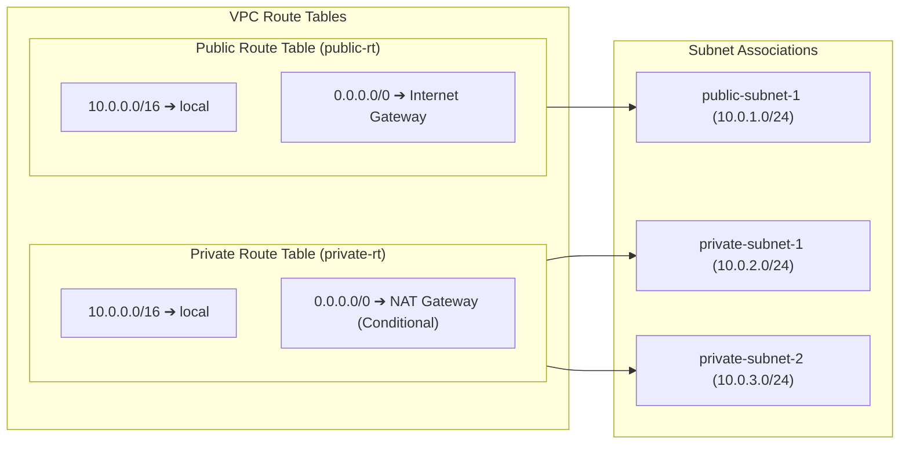

# Cloud Infrastructure Architecture Specification

**Project Title**: VPC with Public and Private Subnets  
**Classification**: Enterprise-Grade Academic Cloud Infrastructure  
**Framework**: AWS Well-Architected Framework (Reliability, Security, Performance Efficiency, Cost Optimization)  

---

## 1. Architectural Philosophy & Design Principles

Modern enterprise cloud architectures abandon flat network topologies in favor of **defense-in-depth network zoning**. The guiding architectural principles of this design are:

1. **Separation of Concerns**: Compute resources serving untrusted public web traffic are strictly segmented from application runtimes and relational data stores.
2. **Principle of Least Privilege**: Inbound access to each tier is restricted strictly to authorized protocols and upstream callers. Outbound access is restricted strictly to mandatory operational ports.
3. **Multi-Availability Zone Resilience**: The network footprint spans multiple AWS Availability Zones (`AZ-A` and `AZ-B`) to fulfill AWS RDS DB Subnet Group high-availability prerequisites while optimizing operational costs.
4. **Zero Plaintext Secrets**: Operational credentials are generated and managed by AWS Secrets Manager, eliminating secret leakage into source repositories.
5. **Declarative Automation**: The entire infrastructure is declared idempotently using HashiCorp Terraform with zero manual configuration.

---

## 2. Complete AWS Components Catalog

| AWS Component | Resource Identifier | Tier / Subnet | Architectural Role |
| :--- | :--- | :--- | :--- |
| **Virtual Private Cloud (VPC)** | `aws_vpc.main` | Network Layer | Root boundary (`10.0.0.0/16`) providing private virtual network isolation with DNS hostnames and resolution enabled. |
| **Public Subnet** | `aws_subnet.public` | Public Web Tier | Hosts public-facing EC2 web server and NAT Gateway (`10.0.1.0/24` in AZ-A). Has route to IGW and public IPv4 allocation. |
| **Private Subnet 1 (App)** | `aws_subnet.private` | Private App Tier | Hosts internal backend workloads and RDS Subnet Group Member 1 (`10.0.2.0/24` in AZ-A). Zero direct internet ingress. |
| **Private Subnet 2 (DB)** | `aws_subnet.private_db` | Private DB Tier | Hosts RDS Subnet Group Member 2 (`10.0.3.0/24` in AZ-B). Satisfies AWS RDS regional multi-AZ requirement. |
| **Internet Gateway (IGW)** | `aws_internet_gateway.main` | Gateway Layer | Attached to VPC; performs stateless 1:1 NAT between public subnets and the internet. |
| **NAT Gateway & EIP** | `aws_nat_gateway.main` | Public Web Tier | Conditional managed gateway enabling private subnets to initiate outbound internet requests without receiving inbound connections. |
| **Public Route Table** | `aws_route_table.public` | Routing Layer | Routes `0.0.0.0/0 -> IGW`. Associated exclusively with `public-subnet-1`. |
| **Private Route Table** | `aws_route_table.private` | Routing Layer | Routes `0.0.0.0/0 -> NAT Gateway` (when enabled). Associated with both private subnets. |
| **Web Security Group** | `aws_security_group.web` | Security Layer | Permits inbound HTTP 80 & HTTPS 443; disables open SSH; enforces least-privilege egress. |
| **Database Security Group** | `aws_security_group.db` | Security Layer | Permits inbound MySQL 3306 **strictly from Web SG ID**; blocks public internet traffic. |
| **EC2 Web & App Server** | `aws_instance.web` | Public Web Tier | Ubuntu 22.04 LTS running Apache reverse proxy and Gunicorn Python Flask backend. |
| **Amazon RDS MySQL** | `aws_db_instance.mysql` | Private DB Tier | MySQL 8.0 engine (`db.t3.micro`, 20 GB gp2), encrypted at rest, `publicly_accessible = false`. |
| **IAM Role & Profile** | `aws_iam_role.ec2_ssm_role` | Identity & Access | Grants `AmazonSSMManagedInstanceCore` for keyless terminal and scoped `secretsmanager:GetSecretValue`. |
| **AWS Secrets Manager** | `aws_secretsmanager_secret` | Security & Secrets | Automatically generates and manages database master credentials. |
| **CloudWatch Alarms & Dashboard** | `aws_cloudwatch_dashboard` | Observability | Operations dashboard tracking CPU, network, connections, and automated alarms. |

---

## 3. CIDR Allocation & Subnet Address Budgeting

The network uses RFC 1918 private IPv4 block `10.0.0.0/16`. Subnets are systematically partitioned into `/24` blocks (256 addresses each):

```text
10.0.0.0/16 Total VPC Space (65,536 Addresses)
├── 10.0.1.0/24  - Public Subnet 1 (AZ-A)       [251 Usable Hosts]  (EC2 Web + NAT Gateway)
├── 10.0.2.0/24  - Private Subnet 1 (AZ-A)      [251 Usable Hosts]  (App Tier / DB Subnet Group 1)
├── 10.0.3.0/24  - Private Subnet 2 (AZ-B)      [251 Usable Hosts]  (RDS MySQL / DB Subnet Group 2)
└── 10.0.4.0/24 to 10.0.255.0/24               [64,768 Available]  (Unallocated Future Expansion)
```

### AWS Reserved Addresses per Subnet
Within every `/24` subnet, AWS reserves 5 addresses:
1. `10.0.x.0`: Network address.
2. `10.0.x.1`: Reserved by AWS for VPC virtual router.
3. `10.0.x.2`: Reserved by AWS for Amazon Route 53 DNS resolver.
4. `10.0.x.3`: Reserved by AWS for future operational use.
5. `10.0.x.255`: Network broadcast address (VPC does not support broadcast).

---

## 4. Routing Architecture & Separation Matrix



- **Isolation Guarantee**: Private subnets are never associated with `public-rt`.
- **Egress Guarantee**: Private subnets contain no route pointing to an Internet Gateway (`igw-*`).

---

## 5. End-to-End Packet Trace & Traffic Flow

### Inbound Web Request (Client &rarr; Apache &rarr; Flask &rarr; RDS)
```text
[Internet User]
      │ HTTP Port 80 (TCP Handshake)
      ▼
[AWS Edge / Internet Gateway]
      │ Translates Public IP to EC2 Private IP (10.0.1.x)
      ▼
[Public Route Table] ── (Routes 10.0.1.0/24 to Public Subnet)
      │
      ▼
[Web Security Group] ── (Evaluates Port 80 Ingress: ALLOWED)
      │
      ▼
[Apache Web Server (10.0.1.x:80)]
      │ Matches /api/visitors ── Reverse Proxies to 127.0.0.1:5000
      ▼
[Python Flask Backend (Gunicorn WSGI)]
      │ Queries AWS Secrets Manager via IAM Role for DB Password
      │ Establishes TCP Connection on Port 3306
      ▼
[VPC Local Virtual Router] ── (10.0.0.0/16 -> local, Cross-AZ to 10.0.3.x)
      │
      ▼
[Database Security Group] ── (Validates Source SG == web-sg: ALLOWED)
      │
      ▼
[Amazon RDS MySQL (10.0.3.x:3306)] ── Executes Parameterized Query
```

---

## 6. Observability & Monitoring Architecture

Observability is configured in [`monitoring.tf`](file:///D:/Kottai%20kannan/monitoring.tf):
1. **Centralized CloudWatch Dashboard**:
   - Widget 1: EC2 CPU Utilization (`%`).
   - Widget 2: EC2 Network In / Network Out (`Bytes`).
   - Widget 3: RDS MySQL CPU Utilization (`%`).
   - Widget 4: RDS MySQL Active Database Connections & Freeable Memory.
2. **Automated Metric Alarms**:
   - `ec2-high-cpu`: Triggers if EC2 CPU &ge; 80% for 10 consecutive minutes (2 periods &times; 300s).
   - `rds-high-cpu`: Triggers if RDS CPU &ge; 80% for 10 consecutive minutes.
   - `rds-low-memory`: Triggers if RDS freeable memory drops below 64 MB.
