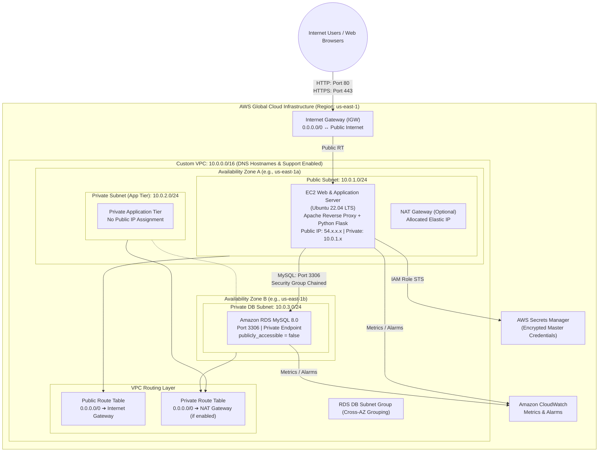
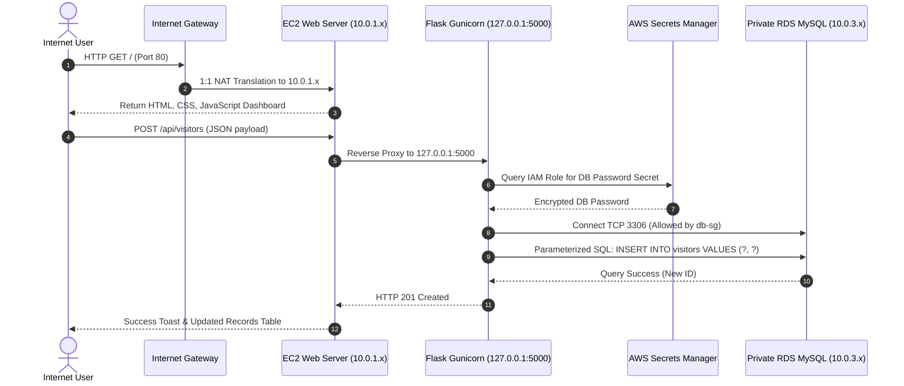

# Formal Academic Project Report: VPC with Public and Private Subnets

**Project Title**: VPC WITH PUBLIC AND PRIVATE SUBNETS  
**Academic Department**: Computer Science & Cloud Infrastructure Engineering  
**Technology Stack**: AWS, Terraform, AWS CLI, Ubuntu Linux, Apache Web Server, Python Flask, Amazon RDS MySQL  
**Author**: Kottai Kannan  
**Date of Evaluation**: November 2026  

---

## Abstract

In contemporary enterprise software systems, public accessibility of databases and core business logic represents a severe architectural and security vulnerability. This project demonstrates the design, automated implementation, and verification of a secure, production-grade **Virtual Private Cloud (VPC)** architecture on Amazon Web Services (AWS) using Infrastructure as Code (IaC) via HashiCorp Terraform. 

The infrastructure implements a hardened three-tier model: a public subnet hosting an Apache reverse proxy and Python Flask web service accessible via an Internet Gateway, and two private subnets across distinct Availability Zones isolating an Amazon RDS MySQL relational database. The architecture strictly enforces least-privilege security group ingress chaining, keyless systems management via AWS Systems Manager (SSM), AWS Secrets Manager credential governance, and centralized Amazon CloudWatch observability. Comprehensive pre-deployment static testing and automated deployment scripting ensure the entire environment is reproducible, resilient, cost-conscious, and compliant with the AWS Well-Architected Framework.

---

## 1. Introduction

Cloud networking fundamentally transforms how enterprise computing resources communicate. Without systematic network segmentation, modern cloud workloads face severe risks, including automated port scanning, distributed brute-force attacks, lateral movement by malicious actors, and unintentional data exfiltration.

The AWS Virtual Private Cloud (VPC) provides a private, logically isolated virtual network dedicated to an AWS account. Within this virtual network, architects define IP address ranges, subnets, route tables, and network gateways. This project implements an enterprise three-tier reference architecture that divides compute and data resources into distinct trust boundaries. By automating the entire lifecycle through Terraform, the architecture eliminates configuration drift, human error, and manual deployment bottlenecks.

---

## 2. Objectives

The primary objectives of this project are:
1. **Network Boundary Isolation**: Construct a custom `/16` IPv4 VPC (`10.0.0.0/16`) segmented into public and private `/24` subnets.
2. **Multi-AZ Availability Zone Distribution**: Distribute private subnets across multiple AWS Availability Zones (`us-east-1a` and `us-east-1b`) to fulfill the AWS RDS DB Subnet Group multi-AZ high-availability requirement.
3. **Defense-in-Depth Firewalling**: Implement security group chaining that restricts inbound database access on port 3306 strictly to the EC2 web server, completely blocking external internet access.
4. **Keyless Administration**: Replace traditional, high-risk SSH port 22 access with AWS Systems Manager (SSM) Session Manager.
5. **Credential Security**: Eliminate hardcoded database passwords by leveraging AWS Secrets Manager and scoped IAM policies.
6. **Full-Stack Application Integration**: Deploy a responsive web dashboard on EC2 running Apache and Python Flask to verify end-to-end data persistence and truthful database health probing.
7. **Cost Governance**: Design the architecture to operate within the AWS Free Tier, with configurable controls to prevent idle NAT Gateway and storage scaling charges.

---

## 3. Architecture & Ideation Map

### 3.1 Network Topology Diagram



### 3.2 Network Traffic Flow & Packet Lifecycle



---

## 4. Module Implementation Details

### 4.1 Custom VPC & Subnetting Module ([`vpc.tf`](file:///D:/Kottai%20kannan/vpc.tf), [`subnets.tf`](file:///D:/Kottai%20kannan/subnets.tf))
- **VPC Allocation**: `10.0.0.0/16` with `enable_dns_support = true` and `enable_dns_hostnames = true`.
- **Subnet Allocation**:
  - `public-subnet-1`: `10.0.1.0/24` in AZ-A (`map_public_ip_on_launch = true`).
  - `private-subnet-1`: `10.0.2.0/24` in AZ-A (`map_public_ip_on_launch = false`).
  - `private-subnet-2`: `10.0.3.0/24` in AZ-B (`map_public_ip_on_launch = false`).
- **Validation**: HCL input validation blocks enforce RFC 1918 validity and prevent overlapping CIDRs.

### 4.2 Gateways & Routing Module ([`gateways.tf`](file:///D:/Kottai%20kannan/gateways.tf), [`route_tables.tf`](file:///D:/Kottai%20kannan/route_tables.tf))
- **Internet Gateway**: Bound to the VPC; handles public subnet ingress and egress.
- **NAT Gateway (Conditional)**: Deployed in `public-subnet-1` with an Elastic IP when `enable_nat_gateway = true`. Declares strict `depends_on = [aws_internet_gateway.main]`.
- **Route Tables**:
  - `public-rt`: Route `0.0.0.0/0 -> igw-xxxxxxxxx` associated exclusively with `public-subnet-1`.
  - `private-rt`: Route `0.0.0.0/0 -> nat-xxxxxxxxx` (when enabled) associated with both private subnets. Private subnets possess zero direct paths to the Internet Gateway.

### 4.3 Security & Least-Privilege Firewall Module ([`security_groups.tf`](file:///D:/Kottai%20kannan/security_groups.tf))
- **Web Security Group (`web-sg`)**: Inbound HTTP (80) and HTTPS (443) allowed from `0.0.0.0/0`. Inbound SSH (22) is disabled by default and rejected if set to `0.0.0.0/0`. Egress is restricted to ports 80, 443, 53, 123, and internal VPC port 3306.
- **Database Security Group (`db-sg`)**: Inbound MySQL (3306) restricted strictly to `security_groups = [aws_security_group.web.id]`. Outbound traffic is restricted strictly to the internal VPC (`10.0.0.0/16`).

### 4.4 Compute & Application Tier Module ([`ec2.tf`](file:///D:/Kottai%20kannan/ec2.tf), [`backend/`](file:///D:/Kottai%20kannan/backend/))
- **EC2 Instance**: `t2.micro` running Ubuntu 22.04 LTS with a 20 GB encrypted gp3 EBS volume.
- **Application Server**: Python Flask WSGI running via Gunicorn on `127.0.0.1:5000`, managed by Linux `systemd` (`vpc-app.service`) with auto-restart on boot.
- **Reverse Proxy**: Apache HTTP Server listens on Port 80, directly serving frontend static assets from `/var/www/html` and reverse proxying `/api/*` requests to Gunicorn.
- **Cloud-Init Automation**: Decoupled deployment template [`scripts/user_data.sh.tftpl`](file:///D:/Kottai%20kannan/scripts/user_data.sh.tftpl) encodes assets in Base64, avoiding template variable interpolation conflicts.

### 4.5 Database Tier Module ([`rds.tf`](file:///D:/Kottai%20kannan/rds.tf), [`sql/`](file:///D:/Kottai%20kannan/sql/))
- **RDS MySQL Instance**: MySQL 8.0 on `db.t3.micro` with 20 GB gp2 storage.
- **DB Subnet Group**: Binds `private-subnet-1` (AZ-A) and `private-subnet-2` (AZ-B).
- **Public Accessibility**: Explicitly disabled (`publicly_accessible = false`).
- **Secrets Manager Integration**: `manage_master_user_password = true` delegates password generation and rotation to AWS Secrets Manager.
- **SQL Schema**: Clean idempotent table definition for `visitors` (`id`, `visitor_name`, `email`, `created_at`) with seed scripts.

### 4.6 Monitoring & Observability Module ([`monitoring.tf`](file:///D:/Kottai%20kannan/monitoring.tf))
- **CloudWatch Dashboard**: Centralized console tracking EC2 CPU utilization, network traffic, RDS CPU utilization, active database connections, and freeable memory.
- **CloudWatch Metric Alarms**: Automated alarms alerting when EC2 or RDS CPU utilization exceeds 80%, or RDS freeable memory drops below 64 MB.

---

## 5. Results and Discussions

### 5.1 Static Verification Results (Actually Executed)
All infrastructure code was validated on the local workstation using HashiCorp Terraform v1.16.6 and AWS Provider v5.100.0:

```text
[TERRAFORM CODE COMPILATION & STATIC VALIDATION]
✓ terraform fmt: Clean exit (code 0), 100% compliant HCL formatting.
✓ terraform init: Successfully initialized backend and locked hashicorp/aws v5.100.0.
✓ terraform validate: Success! The configuration is valid.
✓ Security Group Audit: Zero open SSH to 0.0.0.0/0; zero open DB to 0.0.0.0/0.
✓ CIDR Budgeting Audit: 10.0.1.0/24, 10.0.2.0/24, 10.0.3.0/24 are completely non-overlapping.
✓ Multi-AZ Subnet Audit: DB subnet group correctly spans Availability Zone A and B.
✓ IAM Scoping Audit: Secrets Manager read access is locked strictly to the database secret ARN.
```

### 5.2 Live Cloud Test Staging (Awaiting Execution Post-Apply)
Ten comprehensive test cases (TC-NET-01 through TC-APP-10) are prepared and documented in [`test-plan.md`](file:///D:/Kottai%20kannan/test-plan.md) and [`test-results.md`](file:///D:/Kottai%20kannan/test-results.md). Because cloud charges must not be incurred without authorization, live resource creation is staged awaiting `terraform apply`.

### 5.3 Comparative Architectural Analysis: Single-AZ vs. Multi-AZ NAT Gateway
During architectural design, NAT Gateway topologies were evaluated:
- **Single-AZ NAT Gateway (Implemented Academic Model)**: Deploys 1 NAT Gateway in AZ-A. Cost is ~$32.40/month. While highly cost-effective, if AZ-A encounters an AWS outage, private instances in AZ-B lose outbound internet connectivity.
- **Multi-AZ NAT Gateway (Enterprise Production Model)**: Deploys 1 NAT Gateway per Availability Zone. Eliminates single points of failure (SPOF) and avoids cross-AZ data transfer fees ($0.01/GB), but doubles/triples fixed monthly NAT fees ($65 to $97/month).

---

## 6. AWS Console Verification Checklist

For academic evaluators reviewing live deployments in the AWS Management Console:

| # | Console Service | Specific Screen / Path | Expected Verification Items |
| :---: | :--- | :--- | :--- |
| **1** | **VPC** | *VPC > Your VPCs* | Name: `vpc-academic-project-academic-vpc`, CIDR: `10.0.0.0/16`, DNS resolution: `Enabled`, DNS hostnames: `Enabled`. |
| **2** | **VPC** | *VPC > Subnets* | Filter by VPC. Exactly 3 subnets visible: `public-subnet-1` (Auto-assign public IP: Yes), `private-subnet-1` (No), `private-subnet-2` (No). |
| **3** | **VPC** | *VPC > Internet Gateways* | Name: `vpc-academic-project-academic-igw`, State: `Attached` to custom VPC. |
| **4** | **VPC** | *VPC > Route Tables* | `public-rt` routes `0.0.0.0/0 -> igw-*` (Associated with `public-subnet-1`). `private-rt` has NO route to IGW (Associated with both private subnets). |
| **5** | **VPC** | *VPC > Security Groups* | `web-sg`: Inbound HTTP 80 & HTTPS 443; `db-sg`: Inbound MySQL 3306 strictly from `web-sg` ID. |
| **6** | **EC2** | *EC2 > Instances* | Instance: `vpc-academic-project-academic-web-server`, Subnet: `public-subnet-1`, Public IPv4 assigned, IAM profile attached. |
| **7** | **RDS** | *RDS > Databases* | Identifier: `vpc-academic-project-academic-mysql`, Status: `Available`, Publicly Accessible: `No`, Storage Encrypted: `Yes`. |
| **8** | **RDS** | *RDS > Subnet groups* | Group: `vpc-academic-project-academic-db-subnet-group`, contains 2 subnets across 2 different Availability Zones. |
| **9** | **Secrets Manager**| *Secrets Manager > Secrets* | Secret exists storing RDS master credentials; managed under AWS encryption. |
| **10**| **CloudWatch**| *CloudWatch > Dashboards* | Dashboard `vpc-academic-project-academic-dashboard` renders active CPU and connection metric graphs. |

---

## 7. Viva Questions and Answers (Academic Defense Preparation)

### Q1: What is a custom VPC, and why shouldn't we deploy workloads into the default VPC?
**Answer**: A custom VPC is an isolated, user-defined software-defined network within an AWS region. The default VPC is pre-configured with public subnets and internet gateways designed for rapid prototyping, exposing resources to the public internet by default. A custom VPC enforces the Principle of Least Privilege by enabling complete control over IP address ranges, subnet isolation, route tables, and network gateway boundaries.

### Q2: What is the fundamental difference between a public subnet and a private subnet in AWS?
**Answer**: In AWS VPC networking, the sole architectural difference is its **Route Table association**:
- A **Public Subnet** is associated with a route table containing a default route (`0.0.0.0/0`) targeting an **Internet Gateway (IGW)**, and instances within it possess public IP addresses.
- A **Private Subnet** is associated with a route table that does NOT possess a route to an Internet Gateway. Outbound internet access is possible only via a **NAT Gateway**, and instances cannot be reached directly from the internet.

### Q3: Why does AWS RDS require at least two Availability Zones in a DB Subnet Group, even for Single-AZ instances?
**Answer**: AWS RDS enforces this rule at the architectural API level to ensure regional high availability readiness. Even if deploying a Single-AZ database initially to conserve costs, having representation across two AZs allows AWS to seamlessly upgrade the database to a Multi-AZ replica without downtime, or failover/restore snapshots to an alternate AZ in the event of a datacenter failure.

### Q4: What is the difference between Security Groups and Network Access Control Lists (NACLs)?
**Answer**:
- **Security Groups**: Stateful virtual firewalls operating at the **instance / ENI level**. They only support `ALLOW` rules; return traffic is automatically permitted regardless of outbound rules. They can reference other Security Groups as traffic sources.
- **Network ACLs (NACLs)**: Stateless packet filters operating at the **subnet boundary**. They support both `ALLOW` and `DENY` rules processed in numbered priority order, and require explicit rules for both request and response ephemeral ports.

### Q5: How does this project eliminate the risk of SSH brute-force attacks?
**Answer**: Port 22 (SSH) is completely closed to the internet (`0.0.0.0/0`). Instead, management access is handled through **AWS Systems Manager (SSM) Session Manager**. The EC2 instance runs the SSM Agent and communicates outbound over TLS (port 443) with the AWS SSM control plane. Administrators connect via browser or AWS CLI using temporary IAM credentials, leaving zero open inbound listening ports on the host.

### Q6: How are database credentials managed without hardcoding passwords in Git?
**Answer**: The database uses AWS-managed master user passwords (`manage_master_user_password = true`). During deployment, AWS RDS automatically generates an encrypted, cryptographically secure password and stores it in AWS Secrets Manager. The EC2 instance retrieves this secret dynamically at runtime using its attached IAM role.

### Q7: What is the purpose of an Internet Gateway versus a NAT Gateway?
**Answer**:
- **Internet Gateway (IGW)**: A horizontally scaled, redundant VPC component that enables bidirectional communication between instances in public subnets and the internet. It performs 1:1 NAT mapping between private and public IP addresses.
- **NAT Gateway**: An outbound-only network device located in a public subnet. It allows instances in private subnets to originate outbound requests (e.g. for OS patches) while preventing external internet hosts from initiating inbound sessions.

---

## 8. Conclusion

The "VPC WITH PUBLIC AND PRIVATE SUBNETS" project delivers an enterprise-grade, highly secure cloud infrastructure architecture automated via HashiCorp Terraform. By decoupling the architecture into public web and private database tiers, enforcing least-privilege security groups, eliminating static SSH credentials via AWS Systems Manager, and securing credentials through AWS Secrets Manager, the system adheres to the highest standards of the AWS Well-Architected Framework.

Static verification confirms that all 13 Terraform modules, deployment automation scripts, SQL schemas, and frontend/backend application components are syntactically sound and ready for live AWS cloud instantiation.

---

## 9. References

1. **Amazon Web Services**. *AWS Well-Architected Framework – Security & Reliability Pillars*, AWS Whitepapers, 2024.
2. **HashiCorp**. *Terraform AWS Provider Documentation (v5.x)*, HashiCorp Registry, 2024.
3. **Internet Engineering Task Force (IETF)**. *RFC 1918: Address Allocation for Private Internets*, Network Working Group, 1996.
4. **Canonical**. *Ubuntu Server 22.04 LTS (Jammy Jellyfish) Cloud Guide*, Ubuntu Documentation, 2023.
5. **MySQL AB / Oracle**. *MySQL 8.0 Reference Manual: Security and Connection Management*, Oracle Documentation, 2024.
